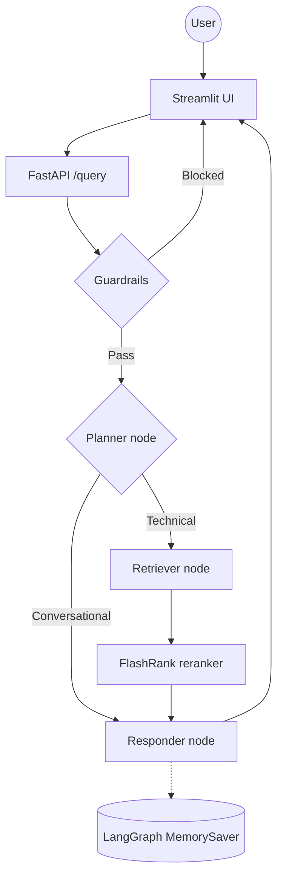

# Enterprise Agentic RAG

An enterprise RAG assistant for Kubernetes, Intel hardware and networking questions, built with **LangGraph**, **NeMo Guardrails**, **Qdrant**, **Jina Embeddings v4** and **Groq** models (optionally routed through the **Portkey** LLM gateway). It decides whether a question needs documentation search, retrieves and re-ranks the best chunks, and answers with conversation memory. Off-topic, jailbreak and sensitive requests are stopped before any retrieval happens.

## Key Features

- **Agentic flow**: LangGraph planner, retriever and responder nodes, with per-session conversation memory.
- **Two-layer guardrails**: NeMo Guardrails matches the message against example intents (off-topic, jailbreak, sensitive topics, greetings) by embedding similarity, with no LLM call. A small LLM check catches anything the examples miss. Details in [REQUEST_FLOW.md](REQUEST_FLOW.md).
- **Semantic search**: Jina Embeddings v4 (2048-dim) with Qdrant Cloud for vector search, then FlashRank (local) for re-ranking.
- **LLM gateway**: Portkey for fallback, retry and caching, with a simple `USE_GATEWAY=false` switch to call Groq directly.
- **Local document parsing**: PDF, HTML, TXT, DOCX and PPTX are parsed on the machine, with no external OCR service.
- **Observability**: Pydantic Logfire spans across every step, plus optional LangSmith tracing.

---

## How a request flows



A step-by-step walkthrough with file and line references is in [REQUEST_FLOW.md](REQUEST_FLOW.md).

---

## Project Structure

```text
├── app/
│   ├── agents/
│   │   └── nodes/       # Planner, Retriever, Responder LangGraph nodes
│   ├── gateway/         # LLM gateway: Portkey routing, or direct Groq
│   ├── guardrails/      # NeMo Guardrails rules + LLM fallback check
│   ├── ingestion/
│   │   ├── chunking/    # Paragraph-based text splitter
│   │   └── loaders/     # Local parsers: PDF, HTML, TXT, DOCX, PPTX
│   ├── services/
│   │   └── retrieval/   # Jina embeddings, Qdrant search, FlashRank reranking
│   ├── config.py        # Environment variable settings
│   └── main.py          # FastAPI entrypoint: guardrails gate + /query endpoint
├── ui/                  # Streamlit chat interface with reasoning-step display
├── DATA/                # Source documents to ingest
├── processed_data/      # Generated: parsed and chunked JSON per document
├── REQUEST_FLOW.md      # End-to-end request flow and diagrams
├── DEPLOYMENT.md        # Docker and Render deployment guide
└── requirements.txt
```

---

## Tech Stack

| Layer | Technology |
|-------|-----------|
| Orchestration | LangChain + LangGraph |
| LLMs | Groq-hosted models, optionally via **Portkey** |
| Guardrails | NeMo Guardrails (embedding-based intents) + small LLM check |
| Vector DB | Qdrant Cloud |
| Embeddings | Jina `jina-embeddings-v4` (2048-dim) |
| Reranking | FlashRank (local) |
| Document parsing | pypdf + pdfplumber, python-docx, python-pptx, BeautifulSoup |
| API / UI | FastAPI + Streamlit |
| Observability | Pydantic Logfire + LangSmith (optional) |

---

## Getting Started

### 1. Install dependencies

Use **Python 3.12**. Newer versions (3.14) are missing prebuilt packages for some dependencies and the install will fail.

```powershell
py -3.12 -m venv .venv
.\.venv\Scripts\activate
pip install -r requirements.txt
```

### 2. Configure environment

Create a `.env` file in the project root. **Never commit it** (it is already in `.gitignore`).

```env
# LLM (Groq)
GROQ_API_KEY=

# Embeddings (Jina)
JINA_API_KEY=

# Vector DB (Qdrant)
QDRANT_CLUSTER_ENDPOINT=        # e.g. https://your-cluster.cloud.qdrant.io:6333
QDRANT_API_KEY=

# LLM gateway (Portkey). Skip these if you set USE_GATEWAY=false
PORTKEY_API_KEY=
# USE_GATEWAY=false             # call Groq directly instead of through Portkey
# DIRECT_GROQ_MODEL=            # model to use when the gateway is bypassed

# Guardrails: model for the fallback check (default: qwen/qwen3.8-27b)
# GUARD_GROQ_MODEL=

# Observability
LOGFIRE_TOKEN=
LANGSMITH_TRACING=false         # set to true and fill the keys below to enable
# LANGSMITH_API_KEY=
# LANGSMITH_PROJECT=

# Streamlit UI -> FastAPI
BACKEND_URL=http://localhost:8000
```

### 3. Run data ingestion

Parses every document in `DATA/`, chunks it, saves the result to `processed_data/`, and indexes the vectors into Qdrant.

```powershell
python -m app.ingestion.processor DATA --wipe
```

> `--wipe` drops and recreates the Qdrant collection. Use it the first time, and whenever the embedding model (vector size) changes. Leave it out to append to an existing collection.

### 4. Launch the app

```powershell
# Terminal 1: FastAPI backend
uvicorn app.main:app --reload --port 8000

# Terminal 2: Streamlit UI
streamlit run ui/app.py
```

The API health check is `GET /`, and the workflow graph image is at `GET /graph`.

---

## Documentation

| Guide | What it covers |
|-------|---------------|
| [REQUEST_FLOW.md](REQUEST_FLOW.md) | Every step from user input to LLM response, guardrails in detail, data passed between functions |
| [DEPLOYMENT.md](DEPLOYMENT.md) | Docker build and Render deployment |
