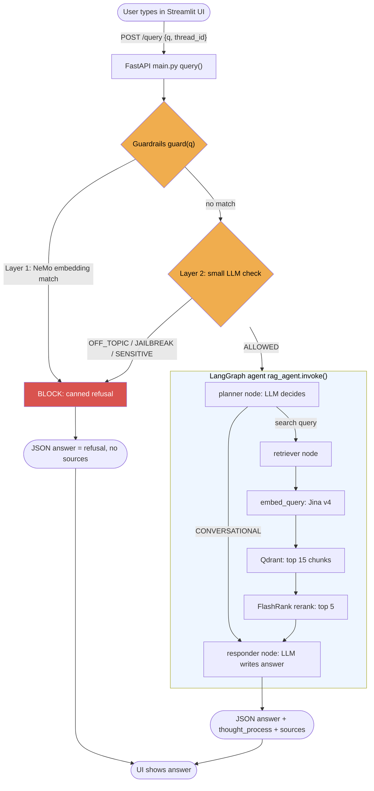
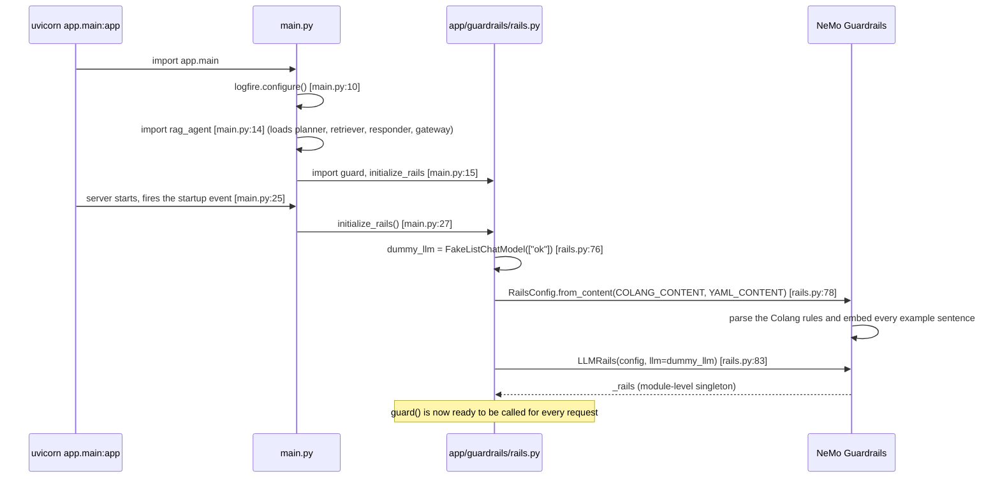
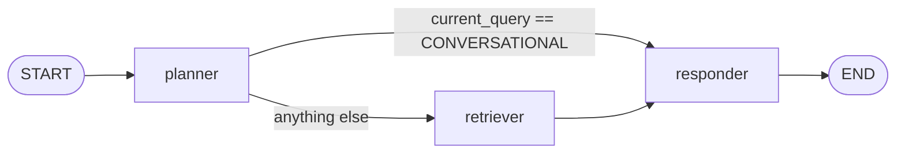
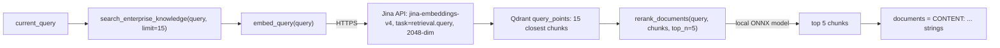
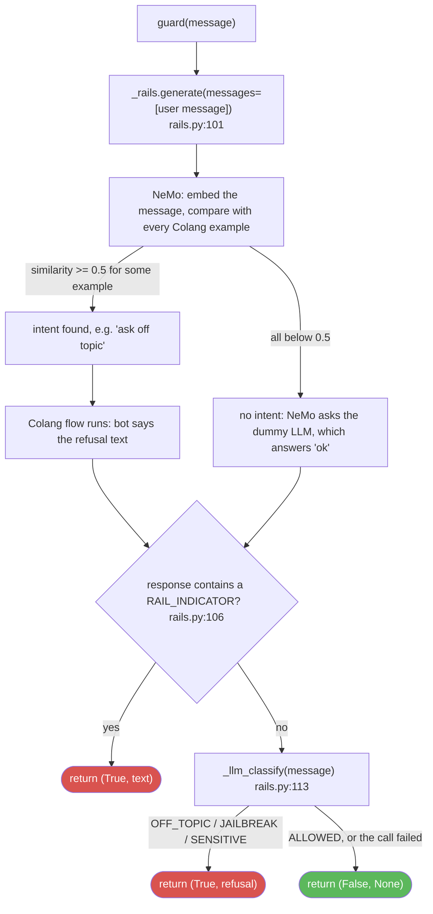
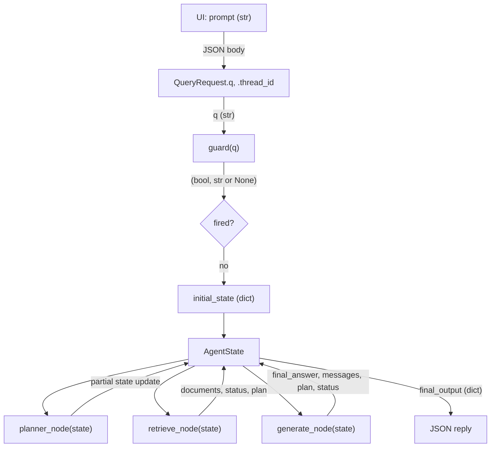

# Request Flow: from user input to LLM response

This document follows **one user message** through the whole system: the UI, the API, the
guardrails, the LangGraph agent, the vector search, and the LLM. For every step it names the
function, the file and the data that is passed on.

> Line numbers (e.g. `main.py:72`) are accurate at the time of writing. If a file changes, search
> for the function name instead.

**Contents**

1. [Big picture](#1-big-picture)
2. [How the guardrails become active (startup)](#2-how-the-guardrails-become-active-startup)
3. [Step-by-step walkthrough of one request](#3-step-by-step-walkthrough-of-one-request)
4. [Guardrails in detail (two layers)](#4-guardrails-in-detail-two-layers)
5. [What the data looks like between functions](#5-what-the-data-looks-like-between-functions)
6. [Memory](#6-memory)
7. [LLM gateway switch](#7-llm-gateway-switch)
8. [How many LLM calls does each path cost?](#8-how-many-llm-calls-does-each-path-cost)
9. [Where to change what](#9-where-to-change-what)
10. [Environment variables](#10-environment-variables)

---

## 1. Big picture



The idea: **cheap checks first, expensive work last.** A blocked message never reaches Qdrant,
the reranker or the main LLM.

---

## 2. How the guardrails become active (startup)

Nothing is "switched on" per request. The guardrails are built **once, when the server starts**.



What happens in each step:

| Step | File | What it does |
|---|---|---|
| Import `main.py` | [main.py](app/main.py) | Configures Logfire first (line 10) so every later import is traced. |
| Import the agent | [graph.py](app/agents/graph.py) | Builds the LangGraph. This imports [planner.py](app/agents/nodes/planner.py), which creates the planner LLM at import time (`planner.py:6`). |
| Startup event | [main.py:25-27](app/main.py#L25-L27) | Calls `initialize_rails()` once. |
| Build NeMo | [rails.py:64-84](app/guardrails/rails.py#L64-L84) | Reads the rules from [colang_rules.py](app/guardrails/colang_rules.py) and stores the NeMo object in the module variable `_rails`. |
| Embed examples | inside NeMo | Every `define user ...` example sentence is turned into a vector (local model, no network). These vectors are what incoming messages are compared with. |

If `initialize_rails()` was never called, `guard()` logs a warning and lets everything through
([rails.py:97-98](app/guardrails/rails.py#L97-L98)).

---

## 3. Step-by-step walkthrough of one request

### Step 0: The UI sends the message
[ui/app.py:74-93](ui/app.py#L74-L93)

```python
payload  = {"q": prompt, "thread_id": st.session_state.session_id}
response = requests.post(f"{BACKEND_URL}/query", json=payload, timeout=60)
```

* `q` is the raw text the user typed.
* `thread_id` is a UUID created once per browser session. It is the key for conversation memory.
* `BACKEND_URL` defaults to `http://localhost:8000`.
  If nothing listens there the UI shows "Backend Offline".

### Step 1: FastAPI receives it
[main.py:29-32](app/main.py#L29-L32) and [main.py:51-68](app/main.py#L51-L68)

* FastAPI validates the body against `QueryRequest` (`q: str`, `thread_id: str`).
* `query()` builds the starting state for the agent:

```python
initial_state = {
    "messages": [{"role": "user", "content": q}],
    "current_query": q,
    "documents": [],
    "plan": ["Start"],
    "status": "Initializing Graph...",
}
config = {"configurable": {"thread_id": thread_id}}   # memory key
```

### Step 2: Gate 1, the guardrails
[main.py:72](app/main.py#L72) calls `guard(q)` from [rails.py:87](app/guardrails/rails.py#L87).

```python
rail_fired, rail_response = guard(q)
if rail_fired:
    return {... "answer": rail_response, "status": "Blocked by guardrails.", "sources": []}
```

`guard()` returns a tuple:

| Return value | Meaning | What `main.py` does |
|---|---|---|
| `(True, "<refusal text>")` | A rail fired | Returns the refusal at once (`main.py:75-82`). The agent is **never** run. |
| `(False, None)` | Message is clean | Continues to Step 3. |

Inside `guard()` there are two layers. See [section 4](#4-guardrails-in-detail-two-layers).

### Step 3: Gate 2, the LangGraph agent
[main.py:85](app/main.py#L85)

```python
final_output = rag_agent.invoke(initial_state, config=config)
```

The graph is defined in [graph.py](app/agents/graph.py):



The routing function is `route_planner` ([graph.py:19-25](app/agents/graph.py#L19-L25)).

#### 3a. Planner node
[planner.py:8-52](app/agents/nodes/planner.py#L8-L52). **One LLM call.**

1. Builds a prompt from the conversation history and the latest message.
2. Asks the LLM to answer with **either** `CONVERSATIONAL` **or** a refined search query
   (`planner.py:38`: `llm.invoke(prompt)`).
3. Writes the decision into the state:

| Decision | State written |
|---|---|
| `CONVERSATIONAL` | `current_query = "CONVERSATIONAL"`, `plan = ["Intent: Conversational/Memory", "Retrieval: Skipped"]` |
| a search query | `current_query = <that query>`, `plan = ["Intent: Technical", "Search Term: ..."]` |

Note: from this point on, `current_query` holds the **planner's refined query**, not the user's
original words. The original text stays in `messages`.

#### 3b. Retriever node (technical questions only)
[retriever.py:6-31](app/agents/nodes/retriever.py#L6-L31)



| Function | File | What it does |
|---|---|---|
| `search_enterprise_knowledge` | [qdrant_service.py:14](app/services/retrieval/qdrant_service.py#L14) | Embeds the query, asks Qdrant for the 15 nearest vectors, returns `{content, source, score}` dicts. On error it logs and returns `[]`. |
| `embed_query` | [embeddings.py:109](app/services/retrieval/embeddings.py#L109) | Calls Jina with `task="retrieval.query"`. Falls back to local sentence-transformers if Jina fails. |
| `rerank_documents` | [ranking_service.py:26](app/services/retrieval/ranking_service.py#L26) | FlashRank cross-encoder (runs locally) re-scores the 15 chunks and keeps the best 5. On error it returns the first 5 in Qdrant order. |

Documents are stored with the passage task (`retrieval.passage`) and queries with
`retrieval.query`. Jina v4 needs this split, so the two sides must stay different.

Writes to state: `documents` (list of `"CONTENT: ..."` strings), `status`, and `plan` (adds
`"Context Retrieved"`).

#### 3c. Responder node
[responder.py:6-87](app/agents/nodes/responder.py#L6-L87). **One LLM call.**

1. Builds `history_str` from all messages except the last.
2. Chooses a prompt:

| Path | Prompt contains | Context |
|---|---|---|
| `current_query == "CONVERSATIONAL"` | conversation history + latest message | none |
| otherwise | retrieved chunks + history + question | chunks, capped at 25,000 characters (`responder.py:35`) |

3. Calls the LLM (`responder.py:61`):
   `portkey_client.chat.completions.create(messages=[...], temperature=0.1)`.
   With the gateway ON this goes through Portkey; with `USE_GATEWAY=false` it goes straight to
   Groq. See [section 7](#7-llm-gateway-switch).
4. Reads `response.choices[0].message.content`, checks the Portkey cache header
   (`extract_cache_status`), and returns:

```python
{"final_answer": content, "status": ..., "plan": ..., "messages": [{"role": "assistant", "content": content}]}
```

### Step 4: API builds the reply
[main.py:87-93](app/main.py#L87-L93)

```python
return {
    "question": q,
    "answer": final_output.get("final_answer"),
    "thought_process": final_output.get("plan"),
    "status": final_output.get("status"),
    "sources": final_output.get("documents", []),
}
```

If anything in Steps 2 to 3 raises, `main.py:94-102` returns a generic apology with
`status: "error"`. The real error goes to Logfire.

### Step 5: The UI shows it
[ui/app.py:95-128](ui/app.py#L95-L128)

* `thought_process` items become the "⚙️" steps inside the status box.
* `sources` (if any) become the expandable "View Retrieved Context".
* `answer` is "typed out" character by character and saved in the chat history.

---

## 4. Guardrails in detail (two layers)

The whole decision happens inside `guard()`, [rails.py:87-119](app/guardrails/rails.py#L87-L119).



### Layer 1: NeMo, by similarity to examples (no LLM)

Files: [colang_rules.py](app/guardrails/colang_rules.py) and [rails.py:101-110](app/guardrails/rails.py#L101-L110).

1. **Examples** live in `COLANG_CONTENT` ([colang_rules.py:12](app/guardrails/colang_rules.py#L12)).
   Each group is `define user <intent>` followed by example sentences:
   off topic (`:13`), jailbreak (`:74`), sensitive (`:95`), plus greeting, capabilities, farewell.
2. **Flows** connect an intent to a reply, e.g. `define flow handle off topic`
   ([colang_rules.py:69](app/guardrails/colang_rules.py#L69)): "if the user intent is off topic,
   the bot says the refusal text".
3. **Matching mode** is set by `embeddings_only: True`
   ([colang_rules.py:181](app/guardrails/colang_rules.py#L181)). NeMo compares the message vector with
   every example vector (cosine similarity) and takes the best match.
4. **Threshold**: the best match counts only if it is at least `0.5`
   ([colang_rules.py:184](app/guardrails/colang_rules.py#L184)). Tuned by testing: at 0.45 and below,
   real technical questions started being blocked.
5. **Detecting that a rail fired**: NeMo returns only text, never a "fired" flag. So `guard()` checks
   whether the text contains one of the known refusal phrases in `RAIL_INDICATORS`
   ([colang_rules.py:199](app/guardrails/colang_rules.py#L199), checked at
   [rails.py:106](app/guardrails/rails.py#L106)).
6. **The dummy LLM**: because intents come from similarity, no real LLM is needed. NeMo still wants an
   LLM object for the "no intent found, so generate a reply" case. We give it `FakeListChatModel(["ok"])`
   ([rails.py:76](app/guardrails/rails.py#L76)). That reply is thrown away, so Layer 1 costs **zero**
   Groq tokens and takes about 0.0 s.

Strength: instant, free, predictable. Weakness: it only catches what looks like the examples.

### Layer 2: small LLM check (for everything the examples missed)

File: [rails.py:43-61](app/guardrails/rails.py#L43-L61), called at [rails.py:113](app/guardrails/rails.py#L113).

"Everything that is not IT" cannot be listed as examples, so messages that Layer 1 let through get one
extra, tiny call to a small model (`GUARD_MODEL`, default `qwen/qwen3.8-27b`,
[rails.py:19](app/guardrails/rails.py#L19)).

* The prompt (`_CLASSIFIER_PROMPT`) asks for exactly one word:
  `ALLOWED`, `OFF_TOPIC`, `JAILBREAK` or `SENSITIVE`.
  Short follow-ups like "thanks" or "what is my name" are defined as `ALLOWED`.
* The word is mapped to the matching refusal text (`_LLM_REPLIES`), which comes from the same constants
  the Colang flows use ([colang_rules.py:8-10](app/guardrails/colang_rules.py#L8-L10)).
* **Fails open.** If Groq is down or rate-limited, the check is skipped, a warning is logged, and the
  message is allowed through. Layer 1 still works in that case.

### Why two layers?

| | Layer 1 (NeMo) | Layer 2 (LLM) |
|---|---|---|
| Speed | about 0.0 s | about 0.2 to 1 s |
| Cost | none | about 250 tokens per message |
| Catches | things similar to the examples | anything, in new wording |
| Needs Groq | no | yes |

---

## 5. What the data looks like between functions



LangGraph passes one shared dictionary, `AgentState` ([state.py](app/agents/state.py)). Each node
receives the whole state and returns **only the keys it wants to change**; LangGraph merges them in.

| Key | Type | Written by | Notes |
|---|---|---|---|
| `messages` | list of `{role, content}` | `main.py`, responder | **Appended**, never replaced (`operator.add`). This is the memory. |
| `current_query` | str | `main.py`, then planner | First the raw question, then the refined query or `"CONVERSATIONAL"`. |
| `documents` | list of str | retriever | The top 5 chunks, each prefixed `CONTENT:`. |
| `plan` | list of str | every node | Shown in the UI as "thought process". |
| `status` | str | every node | Short progress message. |
| `final_answer` | str | responder | Returned to the UI as `answer`. |

Which node reads what:

| Node | Reads | Writes |
|---|---|---|
| planner | `messages` | `current_query`, `status`, `plan` |
| retriever | `current_query`, `plan` | `documents`, `status`, `plan` |
| responder | `current_query`, `messages`, `documents`, `plan` | `final_answer`, `status`, `plan`, `messages` |

---

## 6. Memory

* `rag_agent` is compiled with `MemorySaver` ([graph.py:47-51](app/agents/graph.py#L47-L51)).
  State is saved **per `thread_id`**, so the next request with the same id starts with the old `messages`.
* It is **in-process memory only**. Restarting the server clears every conversation.
* **A message blocked by the guardrails never enters the graph, so it is not saved to memory.**
  Example: "hi, my name is Rahul" matches the greeting rail, gets the canned greeting, and the
  name is never remembered.
* Clicking "Clear History & Memory" in the UI creates a new `thread_id`
  ([ui/app.py:57-61](ui/app.py#L57-L61)), which gives a fresh conversation.

---

## 7. LLM gateway switch

All main LLM calls go through [app/gateway/client.py](app/gateway/client.py).

| `USE_GATEWAY` in `.env` | Planner LLM (`get_langchain_llm`) | Responder LLM (`portkey_client`) |
|---|---|---|
| unset or `true` | `ChatOpenAI` pointed at Portkey (fallback, cache, retry) | Portkey native client |
| `false` | `ChatGroq` directly | a small wrapper that calls the Groq SDK directly |

* The switch is read once at import ([client.py:30](app/gateway/client.py#L30)).
* With `false`, the model is `DIRECT_GROQ_MODEL` ([client.py:31](app/gateway/client.py#L31)).
* `USE_GATEWAY=false` is a **temporary** testing mode. Remove it (and `DIRECT_GROQ_MODEL`) from `.env`
  to go back to Portkey.
* The guardrail LLM check (Layer 2) always calls Groq directly and never uses the gateway.

---

## 8. How many LLM calls does each path cost?

| What the user sends | Guard L1 | Guard L2 | Planner | Jina embed | Qdrant | Rerank | Responder | Main-LLM calls |
|---|---|---|---|---|---|---|---|---|
| Off-topic / jailbreak / sensitive that matches an example | blocks | - | - | - | - | - | - | **0** |
| Off-topic that matches no example | pass | blocks | - | - | - | - | - | **0** (1 tiny guard call) |
| Greeting / farewell / capabilities | blocks | - | - | - | - | - | - | **0** |
| Conversational follow-up ("what is my name?") | pass | pass | 1 | - | - | - | 1 | **2** (+1 tiny guard call) |
| Technical question | pass | pass | 1 | 1 | 1 | 1 (local) | 1 | **2** (+1 tiny guard call, +1 embed call) |

---

## 9. Where to change what

| I want to... | Change this |
|---|---|
| Block a new kind of message | Add example sentences under a `define user ...` block in [colang_rules.py](app/guardrails/colang_rules.py) |
| Add a whole new rail | New `define user`, `define bot`, `define flow` in `COLANG_CONTENT`, plus its refusal phrase in `RAIL_INDICATORS` |
| Change a refusal message | The `*_REPLY` constants at the top of [colang_rules.py](app/guardrails/colang_rules.py) |
| Make matching stricter or looser | `embeddings_only_similarity_threshold` ([colang_rules.py:184](app/guardrails/colang_rules.py#L184)) |
| Change what Layer 2 allows | `_CLASSIFIER_PROMPT` in [rails.py](app/guardrails/rails.py) |
| Change the Layer 2 model | `GUARD_GROQ_MODEL` in `.env` |
| Change how the planner decides | The prompt in [planner.py](app/agents/nodes/planner.py) |
| Change how many chunks are searched or kept | `limit=15` in [retriever.py:16](app/agents/nodes/retriever.py#L16), `top_n=5` in [retriever.py:22](app/agents/nodes/retriever.py#L22) |
| Change the answer style | The prompts in [responder.py](app/agents/nodes/responder.py) |
| Change the embedding model | [embeddings.py](app/services/retrieval/embeddings.py) (and re-ingest, because vector size must match the Qdrant collection) |
| Turn the Portkey gateway on or off | `USE_GATEWAY` in `.env` |

---

## 10. Environment variables

| Variable | Used by | Purpose |
|---|---|---|
| `GROQ_API_KEY` | gateway (direct mode), guardrail Layer 2 | Groq access |
| `PORTKEY_API_KEY` | gateway (Portkey mode) | Portkey access. Not needed if `USE_GATEWAY=false` |
| `USE_GATEWAY` | [client.py](app/gateway/client.py) | `false` bypasses Portkey |
| `DIRECT_GROQ_MODEL` | [client.py](app/gateway/client.py) | Model used when the gateway is bypassed |
| `GUARD_GROQ_MODEL` | [rails.py](app/guardrails/rails.py) | Model for guardrail Layer 2 (default `qwen/qwen3.8-27b`) |
| `JINA_API_KEY` | [embeddings.py](app/services/retrieval/embeddings.py) | Jina v4 embeddings |
| `QDRANT_CLUSTER_ENDPOINT` or `QDRANT_URL` | [config.py:13](app/config.py#L13) | Qdrant address (either name works) |
| `QDRANT_API_KEY` | [config.py](app/config.py) | Qdrant access |
| `LOGFIRE_TOKEN` | [main.py:10](app/main.py#L10), [ui/app.py](ui/app.py) | Tracing |
| `LANGSMITH_TRACING` | [config.py](app/config.py) | Set to `false` to stop the 401 warnings when there is no LangSmith key |
| `BACKEND_URL` | [ui/app.py:89](ui/app.py#L89) | Where the UI finds the API (default `http://localhost:8000`) |
